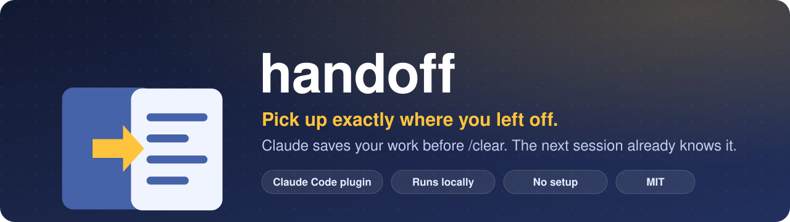
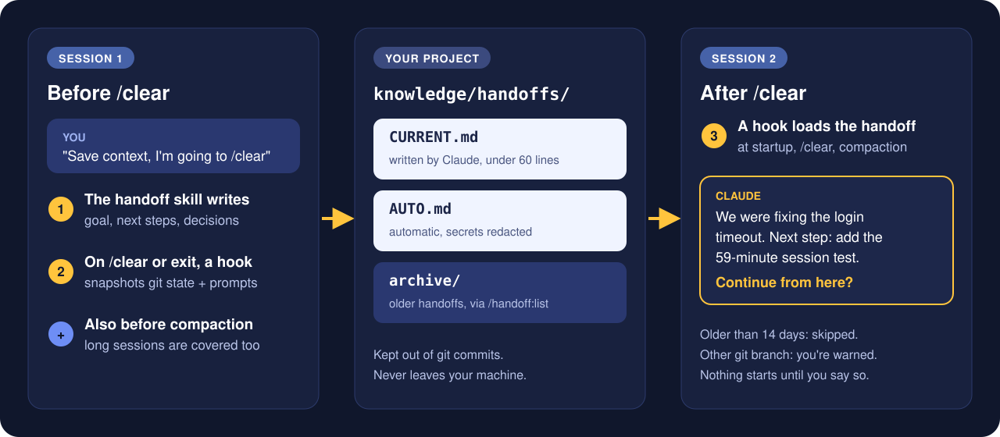

**Session continuity for Claude Code.** Before you `/clear` or close a session, Claude writes a short handoff of the work in progress. The next session loads it automatically, so you never re-explain where you stopped.

---

## ⚡ Install

Run these inside Claude Code, then restart it so the hooks load:

```
/plugin marketplace add kuldeep-jadeja/claude-handoff-plugin
/plugin install handoff@kuldeep-jadeja
```

> [!TIP]
> To update later: `/plugin marketplace update kuldeep-jadeja`, then restart Claude Code.

## 🔄 How it works



## 🧭 Commands

| You do | What happens |
| :-- | :-- |
| Say **"save context"**, **"handoff"** or **"I'm going to clear"** | Claude writes `knowledge/handoffs/CURRENT.md`. An older handoff on another topic moves to `archive/`. |
| `/clear`, restart, or a long session gets compacted | The next session starts with the handoff loaded. Claude says what was in progress and asks before resuming. |
| `/handoff:resume [name or topic]` | Reload the latest handoff, or an archived one, even past the age limit. |
| `/handoff:list` | See current and archived handoffs, newest first, and pick one to load. |
| `/handoff:handoff [topic]` | Same as asking in words: save a handoff now. |

## 📄 What a handoff looks like

```markdown
# Handoff: Login timeout bug
Updated: 2026-11-02 18:40 | Branch: fix/login-timeout | Last commit: 3f2a91c fix(auth): compare TTL in ms

## Goal
Sessions expire after 60 seconds instead of 60 minutes.

## Done
- src/auth/session.js: isExpired() now converts the TTL to milliseconds

## Next steps
1. Add a test in tests/session.test.js for a session that is 59 minutes old.

## Decisions (and why)
- Refresh-token logic left alone: the product team is redesigning it.

## State to know
- Uncommitted: tests/session.test.js
- Running: nothing
```

## 🛡️ Safe by default

| Guarantee | How |
| :-- | :-- |
| 🔒 **No secrets** | The skill never writes passwords, keys or tokens. The automatic snapshot redacts them (API keys, tokens, private keys, credentials in URLs). |
| 🙈 **Out of your commits** | Hooks add `/knowledge/handoffs/` to `.git/info/exclude`, which is local to your clone. Your `.gitignore` is not touched. |
| ⏳ **No stale context** | Handoffs older than 14 days are not loaded, so an old task never steers a new one. `/handoff:resume` still loads them. |
| 🌿 **Branch aware** | If a handoff was written on another git branch, Claude tells you before resuming. |
| 🪶 **Light on tokens** | About 116 tokens per session. When you saved a handoff, the automatic snapshot drops that session's prompts. |
| 💻 **Local only** | No network requests. Nothing leaves your machine. |

## 🔍 What it runs, reads and writes

| Part | Runs | Reads | Writes |
| :-- | :-- | :-- | :-- |
| Hooks (`hooks/hooks.json`) | `python3` (or `python`) on `scripts/handoff.py`, standard library only | `knowledge/handoffs/*.md`; the session transcript Claude Code passes to the hook (only your last 8 prompts, redacted); read-only `git branch`, `git status`, `git log`, `git rev-parse` | `knowledge/handoffs/AUTO.md`; one line in `.git/info/exclude` |
| `handoff` skill | Claude, with your usual permissions | `git` status and log | `knowledge/handoffs/CURRENT.md`; moves older handoffs to `knowledge/handoffs/archive/` |
| `/handoff:resume`, `/handoff:list` | Claude, with your usual permissions | `knowledge/handoffs/`, `git branch` | Nothing, unless you ask to make an archived handoff the current one |

The hooks add the handoff text to the session's context at startup, after `/clear` and after compaction. They don't change any Claude Code setting or permission.

## ⚙️ Requirements and settings

- **Python 3** on your PATH, as `python3` or `python`. On Windows, install it from python.org and tick "Add python.exe to PATH".
- **Git** is recommended for branch and commit info, but not required.

Optional environment variables, for example in the `env` block of `~/.claude/settings.json`:

| Variable | Default | What it does |
| :-- | :-- | :-- |
| `HANDOFF_MAX_AGE_DAYS` | `14` | Handoffs older than this are not loaded at startup. `0` loads them at any age. |
| `HANDOFF_GIT_EXCLUDE` | `1` | Set to `0` if you want to commit your handoffs. |

## 🩺 Troubleshooting

<details>
<summary><b>The new session doesn't mention the handoff</b></summary>

Restart Claude Code after installing or updating. Check that `knowledge/handoffs/CURRENT.md` exists in the project you opened and is less than 14 days old, or run `/handoff:resume`.
</details>

<details>
<summary><b>Nothing happens at all</b></summary>

Run `python3 --version` (or `python --version` on Windows). The hooks stay silent when Python is missing.
</details>

<details>
<summary><b>The handoff shows up twice</b></summary>

You also have the same hooks in a project or user `settings.json`. Remove one copy.
</details>

<details>
<summary><b>Handoffs show up in <code>git status</code></b></summary>

They were committed before you installed the plugin. Run `git rm -r --cached knowledge/handoffs` once.
</details>

<details>
<summary><b>I want my handoffs in the repo</b></summary>

Set `HANDOFF_GIT_EXCLUDE=0` and delete the `/knowledge/handoffs/` line from `.git/info/exclude`.
</details>

## 🧪 Evals

Tested with `claude plugin eval`, comparing Claude with and without the plugin:

| Case | With plugin | Without |
| :-- | :-: | :-: |
| Saves a handoff on "I'm going to /clear", in the template, with the key facts | ✅ 1.00 | ❌ 0.00 |
| Keeps a password and an API key out of the handoff | ✅ 1.00 | ❌ 0.00 |
| `/handoff:resume` summarises, warns about the branch, waits before working | ✅ 1.00 | 0.89 |

Cases and how to run them: [evals/README.md](evals/README.md).

## 📝 Changelog

- **1.2.2**: new README with banner and diagram (fixes the broken Mermaid chart).
- **1.2.1**: plugin moved to the repository root; README lists everything the plugin runs, reads and writes.
- **1.2.0**: `/handoff:resume` and `/handoff:list`; leaner automatic snapshot; eval suite.
- **1.1.0**: reload after compaction; skip handoffs older than 14 days; branch warning; keep handoffs out of commits; Windows support.
- **1.0.0**: first release.

---

MIT © [Kuldeep Jadeja](https://github.com/kuldeep-jadeja)
