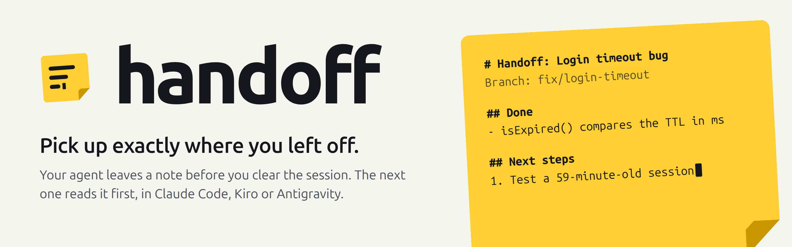
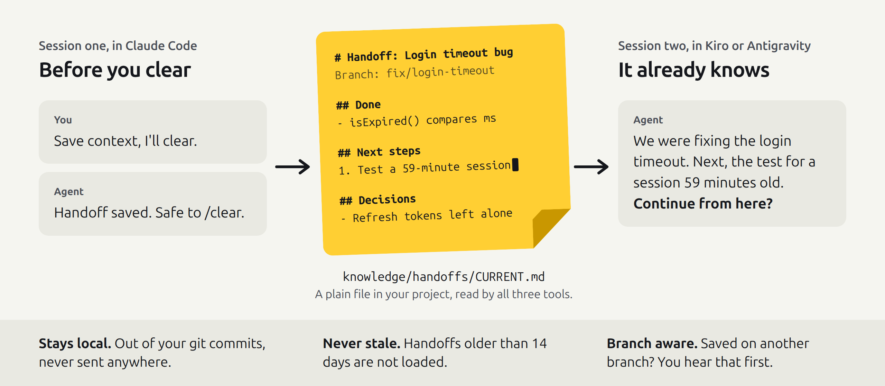
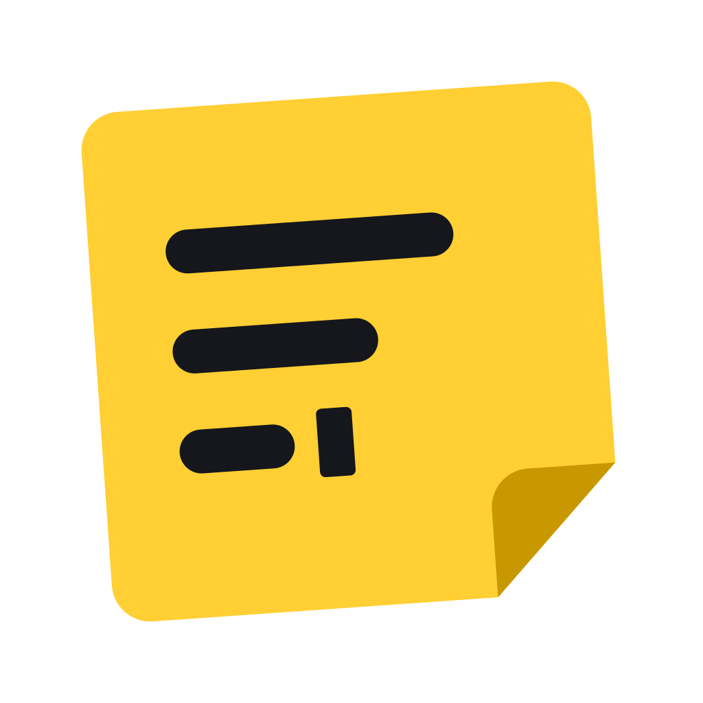

<picture>
  <source media="(prefers-color-scheme: dark)" srcset="assets/banner-dark.png">
  
</picture>

You clear the session, restart, or a long conversation gets compacted, and the agent forgets what it was doing. **handoff** fixes that. Before you clear, the agent writes a short note: the goal, what is done, the very next step, and the decisions made along the way. The next session loads that note first, tells you in one line where you stopped, and asks before carrying on.

It works in **Claude Code**, **Google Antigravity** and **Kiro**. All three use the same `knowledge/handoffs/` folder in your project, so you can stop in one tool and pick up in another.

<br>

<picture>
  <source media="(prefers-color-scheme: dark)" srcset="assets/how-it-works-dark.png">
  
</picture>

## Install

### Claude Code

Inside Claude Code, then restart it so the hooks load:

```
/plugin marketplace add kuldeep-jadeja/claude-handoff-plugin
/plugin install handoff@kuldeep-jadeja
```

To update later, run `/plugin marketplace update kuldeep-jadeja` and restart.

### Antigravity

```bash
agy plugin install https://github.com/kuldeep-jadeja/claude-handoff-plugin
```

No CLI? Clone the repository into the plugins folder, which the Antigravity IDE and App read too:

```bash
git clone https://github.com/kuldeep-jadeja/claude-handoff-plugin ~/.gemini/config/plugins/handoff
```

Needs Antigravity CLI 1.4 or later, or the 2.x IDE or App. Start a new conversation afterwards. More in [docs/antigravity.md](docs/antigravity.md).

### Kiro

```bash
curl -fsSL https://raw.githubusercontent.com/kuldeep-jadeja/claude-handoff-plugin/main/kiro/install.sh | bash
```

That installs the skills and the Kiro CLI hooks in `~/.kiro/`. The Kiro IDE reads hooks per project, so in each project where the handoff should load by itself, run this from the project folder:

```bash
curl -fsSL https://raw.githubusercontent.com/kuldeep-jadeja/claude-handoff-plugin/main/kiro/install.sh | bash -s -- --project
```

<details>
<summary>Windows (PowerShell)</summary>

```powershell
irm https://raw.githubusercontent.com/kuldeep-jadeja/claude-handoff-plugin/main/kiro/install.ps1 | iex
& ([scriptblock]::Create((irm https://raw.githubusercontent.com/kuldeep-jadeja/claude-handoff-plugin/main/kiro/install.ps1))) -Project
```

The second line adds the hooks to the current project, for the Kiro IDE.
</details>

More in [docs/kiro.md](docs/kiro.md).

### Just the skill, in any agent

No plugin, no hooks, no Python: one `SKILL.md` that saves, resumes and lists handoffs in the same format. Put it in your tool's skills folder.

| Tool | Every project | One project |
| :-- | :-- | :-- |
| Claude Code | `~/.claude/skills/handoff/SKILL.md` | `.claude/skills/handoff/SKILL.md` |
| Antigravity | `~/.gemini/config/skills/handoff/SKILL.md` | `.agents/skills/handoff/SKILL.md` |
| Kiro | `~/.kiro/skills/handoff/SKILL.md` | `.kiro/skills/handoff/SKILL.md` |

```bash
mkdir -p ~/.claude/skills/handoff
curl -fsSL https://raw.githubusercontent.com/kuldeep-jadeja/claude-handoff-plugin/main/skill/handoff/SKILL.md \
  -o ~/.claude/skills/handoff/SKILL.md
```

<details>
<summary>Windows (PowerShell), and what the skill can and can't do</summary>

```powershell
New-Item -ItemType Directory -Force "$HOME\.claude\skills\handoff" | Out-Null
Invoke-WebRequest https://raw.githubusercontent.com/kuldeep-jadeja/claude-handoff-plugin/main/skill/handoff/SKILL.md `
  -OutFile "$HOME\.claude\skills\handoff\SKILL.md"
```

Change the folder for the other tools.

| You do | What happens |
| :-- | :-- |
| Say "handoff" or "I'm going to clear", or `/handoff [topic]` | The agent writes `knowledge/handoffs/CURRENT.md`, as the plugins do. |
| Say "resume", or `/handoff resume [name or topic]` | It reads the handoff, gives you the next step, warns about another branch, and asks before working. |
| `/handoff list` | Current and archived handoffs, newest first. Pick one to load. |
| `/handoff setup` | Adds a short always-on instruction (to `CLAUDE.md`, a Kiro steering file or an Antigravity rule, for this project or all of them) so new sessions look for a handoff by themselves. |

Without hooks, a new session doesn't load the handoff until you say "resume" or run `/handoff setup` once, and there is no automatic snapshot, so save before you clear. Install the skill or the plugin in a tool, not both.
</details>

## Use it

| You want to | Claude Code and Antigravity | Kiro |
| :-- | :-- | :-- |
| Save a handoff | Say "handoff", "save context" or "I'm going to clear", or `/handoff:handoff [topic]` | Same words, or `/handoff [topic]` |
| Pick up where you stopped | Nothing to do: a new session loads it (in Claude Code also after `/clear` and compaction) | Nothing to do: a new session loads it |
| Reload the latest or an older handoff, even past the age limit | Say "resume", or `/handoff:resume [name or topic]` | Say "resume", or `/handoff-resume [name or topic]` |
| See every handoff and pick one | `/handoff:list` | `/handoff-list` |

Saving writes `knowledge/handoffs/CURRENT.md`. A handoff on another topic moves to `knowledge/handoffs/archive/` first; nothing is ever deleted.

## What a handoff looks like

```markdown
# Handoff: Login timeout bug
Updated: 2026-11-02 18:40 | Branch: fix/login-timeout | Last commit: 3f2a91c fix(auth): compare TTL in ms

## Goal
Sessions expire after 60 seconds instead of 60 minutes.

## Done
- src/auth/session.js: isExpired() now converts the TTL to milliseconds

## Next steps
1. Add a test in tests/session.test.js for a session that is 59 minutes old.

## Decisions (and why)
- Refresh-token logic left alone: the product team is redesigning it.

## State to know
- Uncommitted: tests/session.test.js
- Running: nothing
```

Under 60 lines, with file paths, commands and decisions instead of a story. Besides the note the agent writes, the hooks keep `AUTO.md`, a mechanical snapshot of the branch, uncommitted files, recent commits and your last prompts, in case you clear without saving.

## Safe by default

- **No secrets.** The skill never writes passwords, keys or tokens; it names the environment variable instead. The automatic snapshot redacts API keys, tokens, private keys, credentials in URLs and phrases like "the password is …".
- **Out of your commits.** `/knowledge/handoffs/` goes into `.git/info/exclude`, which is local to your clone. Your `.gitignore` is not touched.
- **Never stale.** Handoffs older than 14 days are not loaded, so an old task never steers a new one. The resume command still opens them.
- **Branch aware.** A handoff written on another git branch is flagged before anything resumes.
- **Light.** About 116 tokens per session. If you saved a handoff, the snapshot leaves that session's prompts out.
- **Local.** No network requests. Nothing leaves your machine.

<details>
<summary><b>What it runs, reads and writes</b></summary>

**Hook script**, `scripts/handoff.py` (Python 3, standard library only), shared by all three tools:
- **Reads** `knowledge/handoffs/*.md`; your last 8 prompts, redacted (from the transcript the tool hands the hook, or in Kiro from the prompt hook); read-only `git branch`, `git status`, `git log`, `git rev-parse`.
- **Writes** `knowledge/handoffs/AUTO.md`, one line in `.git/info/exclude`, and for Kiro and Antigravity a small per-session state file in your temp folder (`handoff-state/`).

| Tool | Hooks file | Events |
| :-- | :-- | :-- |
| Claude Code | `claude/hooks.json` | `SessionStart` (startup, `/clear`, compaction), `PreCompact`, `SessionEnd` |
| Antigravity | `hooks.json` | `SessionStart`, `Stop` |
| Kiro | `~/.kiro/hooks/handoff.json`, `.kiro/hooks/handoff.json` | `SessionStart`, `UserPromptSubmit` (prints nothing), `Stop` |

**Skills**, `skills/handoff`, `skills/resume`, `skills/list` (Kiro's copies in `kiro/skills/`):
- **Run as** the agent, with your usual permissions.
- **Read** `knowledge/handoffs/` and `git`. **Write** `CURRENT.md` and `archive/` when saving; resume and list write nothing unless you ask to make an archived handoff the current one.

**Standalone skill**, `skill/handoff/SKILL.md`: no hooks, no scripts. Writes `CURRENT.md`, `archive/`, one line in `.git/info/exclude`, and, only with `/handoff setup` and your confirmation, the instruction file you pick.

The hooks only add the handoff text to the session's context. They don't change any setting or permission.
</details>

<details>
<summary><b>Requirements and settings</b></summary>

- **Python 3** on your PATH, as `python3` or `python`. On Windows, install it from python.org and tick "Add python.exe to PATH". The standalone skill needs no Python.
- **Git** is recommended for branch and commit info, but not required.

Optional environment variables. In Claude Code, set them in the `env` block of `~/.claude/settings.json`; in Kiro and Antigravity, in the environment the app starts with.

| Variable | Default | What it does |
| :-- | :-- | :-- |
| `HANDOFF_MAX_AGE_DAYS` | `14` | Handoffs older than this are not loaded at startup. `0` loads them at any age. |
| `HANDOFF_GIT_EXCLUDE` | `1` | Set to `0` if you want to commit your handoffs. |
</details>

## Troubleshooting

<details>
<summary>The new session doesn't mention the handoff</summary>

Start a new session after installing or updating (in Claude Code, restart it). Check that `knowledge/handoffs/CURRENT.md` exists in the project you opened and is less than 14 days old, or run the resume command. In the Kiro IDE, the project needs `.kiro/hooks/handoff.json`: run the installer with `--project`. In Antigravity, check the version: IDE builds before 2.x don't load plugins.
</details>

<details>
<summary>Nothing happens at all</summary>

Run `python3 --version` (or `python --version` on Windows). The hooks stay silent when Python is missing.
</details>

<details>
<summary>The handoff shows up twice</summary>

Claude Code: the same hooks are also in a project or user `settings.json`; remove one copy. In Kiro, global and project hooks both run, but the script loads the handoff only once per session.
</details>

<details>
<summary>Handoffs show up in <code>git status</code></summary>

They were committed before you installed the plugin. Run `git rm -r --cached knowledge/handoffs` once.
</details>

<details>
<summary>I want my handoffs in the repo</summary>

Set `HANDOFF_GIT_EXCLUDE=0` and delete the `/knowledge/handoffs/` line from `.git/info/exclude`.
</details>

## Tested

With `claude plugin eval`, comparing Claude Code with and without the plugin:

| Case | With | Without |
| :-- | :-: | :-: |
| Saves a handoff on "I'm going to /clear", in the template, with the key facts | 1.00 | 0.00 |
| Keeps a password and an API key out of the handoff | 1.00 | 0.00 |
| `/handoff:resume` summarises, warns about the branch, waits before working | 1.00 | 0.89 |

Cases and how to run them: [evals/README.md](evals/README.md). Antigravity and Kiro runs: [docs/antigravity.md](docs/antigravity.md#tested), [docs/kiro.md](docs/kiro.md#tested).

## Development

Claude Code and Antigravity load the same skills from `skills/`. Kiro's copies are generated from them, so there is one copy to edit.

```bash
python3 tools/build_skills.py           # regenerate kiro/skills/ after editing skills/
python3 tools/build_skills.py --check   # exit 1 when kiro/skills/ is out of date
python3 tools/render_assets.py          # re-render the README art and icons from assets/src/ (needs Chrome)
claude plugin validate . && agy plugin validate --strict .
```

The logo is `assets/logo.svg`. The banner and diagram are HTML in `assets/src/`, rendered to light and dark PNGs.

<details>
<summary><b>Changelog</b></summary>

- **1.4.1**: new logo (a sticky note with its corner lifting and a cursor where work picks up), new banner and diagram with light and dark versions, and a tidier README.
- **1.4.0**: Antigravity plugin and Kiro skills and hooks, sharing one hook script and handoff format with Claude Code. `/handoff:resume` and `/handoff:list` are now skills, shared with Antigravity (same names, and they also run when you say "resume"); Claude Code's hooks moved to `claude/hooks.json`. Redaction also catches "the password is …". The standalone skill's setup works in Kiro and Antigravity too.
- **1.3.0**: standalone skill (`skill/handoff/SKILL.md`) for people who don't want the plugin: save, resume, list, and an optional `CLAUDE.md` setup so new sessions check for a handoff.
- **1.2.2**: new README with banner and diagram (fixes the broken Mermaid chart).
- **1.2.1**: plugin moved to the repository root; README lists everything the plugin runs, reads and writes.
- **1.2.0**: `/handoff:resume` and `/handoff:list`; leaner automatic snapshot; eval suite.
- **1.1.0**: reload after compaction; skip handoffs older than 14 days; branch warning; keep handoffs out of commits; Windows support.
- **1.0.0**: first release.
</details>

<br>



MIT © [Kuldeep Jadeja](https://github.com/kuldeep-jadeja)
